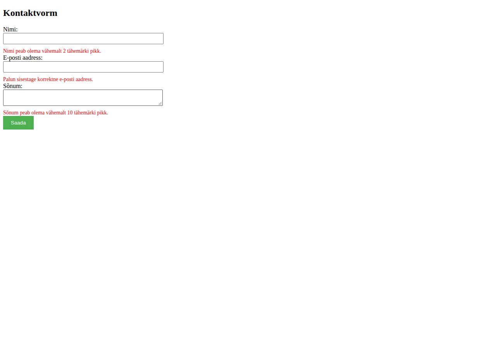
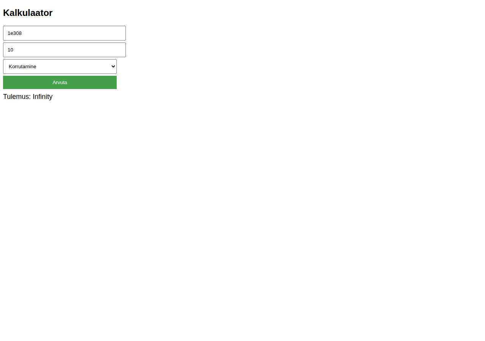
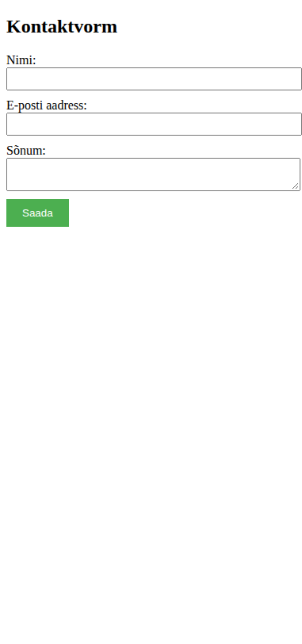
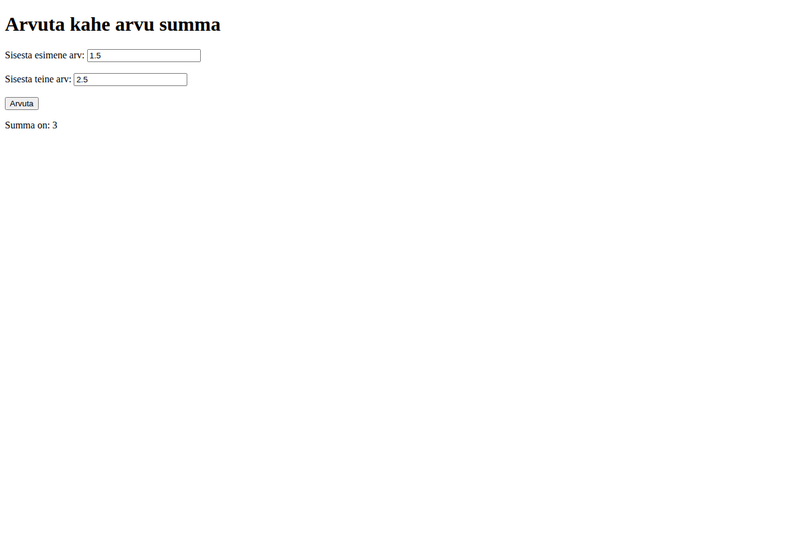

# box-testing-master — testimise dokumentatsioon

| Väli | Väärtus |
|---|---|
| Projekt | `box-testing-master` (black-box, gray-box ja white-box õppemoodulid) |
| Testitav süsteem | Kolm iseseisvat staatilist veebilehte HTML/CSS/JavaScript tehnoloogias |
| Testimise lähenemine | Koodiülevaatus, riskipõhine testidisain, automatiseeritud brauseritestid, käsitsi uuriv testimine |
| Testiraamistik | Playwright 1.65.0 (Chromium 158.0.8127.18) |
| Testide arv | 43 automatiseeritud kontrolli + 3 üksustasandi analüüsi |
| Tulemus | **30 PASS / 13 FAIL / 0 ERROR** (passimäär 69,8%) |
| Leitud defektid | 11 (D-01 … D-11) |
| Testide kestus | 9,97 s (jooks 1) ja 9,91 s (jooks 2) |
| Dokumentatsiooni versioon | 1.0 |
| Koostatud | 16.11.2026 |
| Keel | Eesti |

---

## 1. Sissejuhatus

### 1.1. Dokumendi eesmärk

Käesolev dokument täidab testimise dokumentatsiooni malli `box-testing-master` projekti kohta. Dokument kirjeldab, mida projektis testiti, milliseid testimise tüüpe ja tehnikaid kasutati, millised testjuhtumid koostati, kuidas neid teostati ning millised tulemused ja defektid saadi. Dokument on kirjutatud nii, et iga kirjeldatud kontrolli saaks teine testija samadel tingimustel korrata.

Dokument ei ole üldine teoreetiline ülevaade testimisest. Iga peatükk seob malli nõuded konkreetse projekti failide, testjuhtumite, mõõtmistulemuste ja leitud defektidega.

### 1.2. Testitav projekt

Projekt koosneb kolmest teineteisest sõltumatust väikesest veebirakendusest, mille eesmärk on näidata musta, halli ja valge kasti testimise erinevust.

| Moodul | Failid | Funktsioon | Testimise perspektiiv |
|---|---|---|---|
| Black-box | `black-box/index.html`, `script.js`, `style.css` | Kontaktvorm nimi-, e-posti- ja sõnumiväljaga | Testija lähtub ainult nähtavast kasutajaliidesest, siltidest ja veateadetest; lähtekoodi ei kasutata testide tuletamiseks |
| Gray-box | `gray-box/index.html`, `script.js`, `style.css` | Kalkulaator nelja tehtega (liitmine, lahutamine, korrutamine, jagamine) | Testijal on osaline teadmine DOM-i struktuurist, sündmuste käsitlejast ja tehete harudest |
| White-box | `white-box/white-box.html` | Kahe arvu summa arvutamine ja 100 piiri kontroll | Lähtekood on täielikult nähtav; testid tuletatakse koodi harudest ja piirjuhtudest |

Kõik kolm rakendust töötavad ainult brauseris. Puudub server, andmebaas, API, autentimine ja andmete salvestamine. See mõjutab oluliselt testimise skoopi: suur osa traditsioonilisest integratsiooni-, turbe- ja jõudlustestimisest ei ole selles projektis rakendatav.

### 1.3. Testimise lähenemine

Testimine viidi läbi neljas etapis:

1. **Staatiline analüüs.** Loeti läbi kõik HTML-, CSS- ja JavaScript-failid. See oli eriti oluline halli ja valge kasti moodulis, kus koodist tulid välja sellised ohukohad nagu `parseInt`, `step`-atribuudi puudumine, `switch`-i `default`-haru puudumine ja e-posti regulatsiooni kitsus.
2. **Testidisain.** Kasutati samaväärsusklasse, piirväärtuste analüüsi, otsustustabelit, veaarvamust ja harukatvuse analüüsi. Testjuhtumid said ID-d `BB-01` … `NF-04`.
3. **Automatiseeritud teostamine.** Playwright avas iga testjuhtumi jaoks värske brauserikonteksti, täitis väljad, vajutas nuppe, käsitles `alert`-dialooge ja luges tulemuse DOM-ist. Ebaõnnestumiste kohta tehti ekraanipilt.
4. **Analüüs ja dokumenteerimine.** Tulemused salvestati masinloetavasse faili `tests/results.json`, võrreldi kordusjooksu tulemustega ja koostati defektide register.

Testioraakel põhineb kolmel allikal:

- kasutajaliideses nähtavad sildid ja teated (nt „Nimi peab olema vähemalt 2 tähemärki pikk.“);
- koodist selgelt väljenduv kavatsus (nt kalkulaator peab nelja tehet tegema, summa puhul on 100 piir);
- üldtunnustatud ootused (korrektne e-posti aadress peab olema aktsepteeritav, arvutustulemus ei tohi olla `NaN` ega `Infinity`, veateade peab olema seotud väljaga).

### 1.4. Dokumendi struktuur

1. Sissejuhatus — projekt, lähenemine ja dokumendi ülesehitus.
2. Testimise eesmärk — üldeesmärgid, projekti eesmärgid ja lõpetamise kriteeriumid.
3. Testimise tüübid — seitse malli tüüpi koos projektipõhiste näidetega.
4. Testimise protsess — planeerimine, skoop, teostamine ja lõpetamine.
5. Tööriistad ja tehnoloogiad — tegelik tööriistakomplekt ja malli tööriistade mittekasutamise põhjendus.
6. Parimad praktikad — projektis rakendatud ja mitterakendatud praktikad.
7. Järeldus — valmisolek, peamised õppetunnid ja soovitused.
8. Lisad — testjuhtumite register, defektide register, jälgitavusmaatriks, testandmed ja korduskäivitamine.

---

## 2. Testimise eesmärk

### 2.1. Üldeesmärgid

Malli neli üldeesmärki seoti selle projektiga järgmiselt.

| Üldeesmärk | Konkreetne tähendus selles projektis |
|---|---|
| **Kvaliteedi tagamine** | Veenduda, et kontaktvorm, kalkulaator ja summaarvutus käituvad vastavalt nähtavale spetsifikatsioonile ning et veateated on õiged ja arusaadavad. |
| **Vigade tuvastamine** | Leida valideerimis-, arvutus- ja kasutajaliidese defektid enne, kui neid hakatakse õppematerjalis näidisena kasutama või päris rakendusse üle kandma. |
| **Kasutusmugavus** | Kontrollida siltide olemasolu, klaviatuuriga navigeerimist, veateadete nähtavust, responsiivsust ja seda, kas kasutaja saab vigadest aru. |
| **Süsteemi jõudlus** | Mõõta staatiliste lehtede laadimisaega ja kontrollida, et lehed ei tee väliseid päringuid ega salvesta andmeid. Koormustestimine ei ole rakendatav, sest server puudub. |

### 2.2. Projekti spetsiifilised eesmärgid

1. Kontrollida black-box kontaktvormi valideerimist: nime pikkus vähemalt 2 märki, e-posti aadressi korrektsus, sõnumi pikkus vähemalt 10 märki.
2. Kontrollida, et tühikud eemaldatakse enne valideerimist ja et veateated tühjendatakse enne järgmist valideerimist.
3. Kontrollida kalkulaatori nelja tehet, nulliga jagamist, tühje sisendeid, negatiivseid arve, kümnendarve ja arvulist ületäitumist.
4. Kontrollida white-box summaarvutuse mõlemat haru: summa ≤ 100 ja summa > 100, sealhulgas piirjuhtu 100.
5. Kontrollida, et kasutajaliides on eestikeelne, sildid on väljadega seotud, veateated on nähtavad ja vormi saab esitada klaviatuuriga.
6. Kontrollida põhilisi mittefunktsionaalseid omadusi: lokaalne laadimisaeg, välised päringud, andmete salvestamine, XSS-katse ja konsoolivead.
7. Luua korratav testikomplekt ja dokumenteeritud baastulemus, millega saab hiljem muudatusi võrrelda.

### 2.3. Õnnestumise ja lõpetamise kriteeriumid

| Kriteerium | Sihttase | Tegelik tulemus | Staatus |
|---|---|---|---|
| Kõik planeeritud testjuhtumid on teostatud | 100% | 43/43 (100%) | Täidetud |
| Passimäär | ≥ 90% | 69,8% (30/43) | Ei ole täidetud |
| Kõrge tõsidusega defektid parandatud | 0 avatud P1-defekti | 1 avatud P1-defekt (D-03) | Ei ole täidetud |
| Käsitlemata JavaScripti erindid | 0 | 0 | Täidetud |
| Kordusjooks annab sama tulemuse | 0 erinevust | 0 erinevust | Täidetud |
| Ligipääsetavuse põhikontroll | Vähemalt sildid ja veateadete teadaandmine | Sildid osaliselt, veateated ei ole teadaandmisega seotud | Ei ole täidetud |
| Dokumenteeritud järeldus ja soovitused | Olemas | Olemas (ptk 7) | Täidetud |

Kuna passimäär jäi alla 90% ja üks P1-defekt on avatud, **ei ole projekt testimise lõpetamise kriteeriumite järgi tootmisvalmis**. Õppematerjali ja demorakendusena on see kasutatav, kui defektid on teada ja dokumenteeritud.

---

## 3. Testimise tüübid

### 3.1. Funktsionaalne testimine

**Määratlus.** Funktsionaalne testimine kontrollib, kas tarkvara funktsioonid töötavad vastavalt nõuetele: kas sisendite töötlemine, valideerimine, arvutused ja tulemuse kuvamine annavad oodatud tulemuse.

**Rakendamine.** Kõik kolm moodulit testiti funktsionaalselt. black-box moodulis kasutati ainult kasutajaliidesest nähtavat infot, gray-box moodulis arvestati ka DOM-i ja sündmuste käsitleja struktuuri ning white-box moodulis lähtuti otse koodi harudest.

| Valdkond | Testjuhtumid | PASS | FAIL | Peamine järeldus |
|---|---|---|---|---|
| Black-box kontaktvorm | BB-01 … BB-11 (11) | 8 | 3 | Põhivalideerimine töötab; e-posti regulatsioon on korraga liiga range ja liiga lubav |
| Gray-box kalkulaator | GB-01 … GB-12 (12) | 8 | 4 | Täisarvudega tehted töötavad; kümnendarvud on blokeeritud, ületäitumine ja tundmatu tehe on käsitlemata |
| White-box summa | WB-01 … WB-09 (9) | 6 | 3 | Täisarvuline summa ja 100 piir töötavad; kümnendarvud ja tühjad sisendid ei ole kaitstud |
| **Kokku** | **32** | **22** | **10** | **Põhiteed töötavad, servajuhtudel on süsteemsed puudujäägid** |

**Kasutatud tehnikad.**

- **Samaväärsusklassid.** Nimi: tühi / 1 märk / vähemalt 2 märki. E-post: korrektne / ilma `@`-märgita / muu kehtetu. Sõnum: tühi / 1–9 märki / vähemalt 10 märki. Arvud: kehtiv arv / mittearv / null / väga suur arv.
- **Piirväärtuste analüüs.** Nimi 1 ja 2 märki; sõnum 9 ja 10 märki; summa 99, 100 ja 101; jagaja 0; vaateava laius 375 px.
- **Otsustustabel.** Kalkulaatori tehete ja kontrollide kombinatsioonid: liitmine, lahutamine, korrutamine, jagamine, nulliga jagamine, tühjad sisendid.
- **Veaarvamus.** Suurtähtedega e-post, neljatäheline tippdomeen, topelt-`@`, `1e308` ületäitumine, käsitsi muudetud tehte väärtus, otsekutse tühjade väljadega.
- **Valge kasti haruanalüüs.** `arvutaSumma()` `if/else` harud, kalkulaatori `switch`-i harud ja valideerimise `if`-harud.

**Peamised funktsionaalsed leiud.**

- Kõik positiivsed täisarvulised põhiteed läbisid: kontaktvormi korrektne esitamine, neli kalkulaatortehet, summa ≤ 100 ja summa > 100.
- Piirjuhud nime (2), sõnumi (10) ja summa (100) jaoks läbisid.
- E-posti valideerimine ei vasta tavalistele ootustele: `MARI@EXAMPLE.COM` ja `mari@example.info` lükatakse tagasi, samas kui `a@@b.com` aktsepteeritakse (D-01, D-02).
- `input type="number"` vaikimisi `step="1"` blokeerib kümnendarvud nii kalkulaatoris kui ka summaarvutuses (D-03). See on funktsionaalne piirang, mis mõjutab otseselt kalkulaatori kasutatavust.
- Kalkulaator kuvab ületäitumise korral `Tulemus: Infinity` (D-05) ja tundmatu tehte korral vaikimisi `Tulemus: 0` (D-06).
- White-box funktsioon kasutab `parseInt`, mis kärbib kümnendkohad, ning ei kontrolli tühje sisendeid (D-07, D-08).

### 3.2. Mittefunktsionaalne testimine

**Määratlus.** Mittefunktsionaalne testimine hindab omadusi, mis ei ole otseselt seotud ühegi funktsiooni õigsusega: jõudlus, turvalisus, usaldusväärsus, kasutatavus ja ühilduvus.

**Rakendamine.** Projekti suurus ja arhitektuur (ainult kliendipoolne staatiline kood) piiravad mittefunktsionaalse testimise mahtu. Testiti seda, mida oli võimalik objektiivselt mõõta.

| ID | Omadus | Kontroll | Tulemus |
|---|---|---|---|
| NF-01 | Jõudlus | Kolme lehe laadimisaeg lokaalsest failisüsteemist | PASS — 12 ms, 9 ms ja 7 ms |
| NF-02 | Turvalisus / privaatsus | Välised võrgupäringud, `localStorage`, `sessionStorage`, küpsised | PASS — väliseid päringuid ega salvestust ei ole |
| NF-03 | Turvalisus | XSS-katse HTML- ja skriptisisuga nimi- ja sõnumiväljas | PASS — sisu ei käivitunud, veateated kuvati tekstina |
| NF-04 | Usaldusväärsus | Konsoolivead ja käsitlemata JavaScripti erindid kolmel lehel | PASS — 0 viga |

**Analüüs.**

- **Jõudlus.** Kolme lehe allikfailid on kokku umbes 7 KB (873 B + 1 714 B + 373 B + 845 B + 1 421 B + 643 B + 1 181 B). Lokaalne laadimisaeg jäi vahemikku 7–12 ms. Need numbrid ei iseloomusta tootmisjõudlust, sest puudub võrk, server ja samaaegsete kasutajate koormus. Koormustestimine (JMeter, LoadRunner) ei ole selle projekti jaoks mõttekas.
- **Turvalisus.** Kuna andmeid ei saadeta kuhugi, on turvarisk piiratud. Kontaktvorm kasutab veateadete kuvamiseks `textContent`-i, mis neutraliseerib HTML-i. White-box kasutab `innerHTML`-i, kuid ainult `parseInt`-i tulemusega, mis on arvuline. Samas on valideerimine ainult kliendipoolne ja kergesti möödaviidav (D-02); päris rakenduses oleks vaja serveripoolset valideerimist. CSP-d, `maxlength`-i ja sisendi pikkuse piiranguid ei ole.
- **Usaldusväärsus.** Kaks järjestikust jooksu andsid täpselt samad 43 tulemust. See näitab, et testikomplekt on deterministlik ega sõltu võrgust ega jagatud olekust.
- **Ühilduvus.** Testiti ainult Chromiumi 158.0.8127.18 versiooniga. Firefoxi ja WebKiti ei testitud, sest vastavaid brauserimootoreid selles keskkonnas ei olnud paigaldatud. See on dokumenteeritud piirang, mitte tõestus ühilduvusest.
- **Ligipääsetavus.** Ligipääsetavust kontrolliti kasutajaliidese testidega (ptk 3.6). Tulemused näitavad puudujääke siltide ja veateadete teadaandmise osas (D-09, D-10).

### 3.3. Üksus testimine

**Määratlus.** Üksustestimine kontrollib üksikuid funktsioone, valideerimisreegleid või väikseimaid koodiüksusi eraldi, ilma kogu süsteemi kaasamata.

**Rakendamine.** Projektis ei ole mooduleid, eksporte ega eraldi testiraamistikku. Seetõttu ei olnud võimalik kasutada Jestit, Vitesti ega muud üksustestimise raamistikku ilma koodi ümberkorraldamiseta. Üksustasandi kontrollid tehti kahel viisil:

1. **Otsekutsed brauserikontekstis.** `page.evaluate()` kaudu kutsuti `arvutaSumma()` ja `dispatchEvent('submit')` kaudu kalkulaatori käsitlejat, mööda minnes HTML-i loomulikust valideerimisest. Nii kontrolliti funktsioonide käitumist ka juhtudel, mida kasutajaliides tavaliselt ei luba.
2. **Staatiline haruanalüüs.** Loeti käsitlejate `if`- ja `switch`-harud ning määrati, millised testjuhtumid iga haru katavad.

| Üksus | Kontrollitud harud | Harukatvus | Leitud probleem |
|---|---|---|---|
| Black-box `submit`-käsitleja valideerimine | `name` tühi või < 2; `name` ≥ 2; e-post sobib / ei sobi; `message` tühi või < 10; `message` ≥ 10; `isValid` true/false | 8/8 väljundit (100%) | D-01, D-02 |
| Gray-box `submit`-käsitleja arvutus | `isNaN` kontroll; `add`, `subtract`, `multiply`, `divide`; nulliga jagamine; `default` puudub | 7/7 olemasolevat haru (100%), `default` puudub | D-03, D-05, D-06 |
| White-box `arvutaSumma()` | `parseInt` mõlemale sisendile; liitmine; `> 100` true/false | 2/2 väljundit (100%) | D-07, D-08 |

**Üksustasandi järeldused.**

- `parseInt` sobib ainult täisarvude jaoks. Kui kavatsus on liita kümnendarve, on see vale funktsioon (D-07). Test WB-07 kutsus funktsiooni otse ja sai sisenditega 1,5 ja 2,5 tulemuseks `Summa on: 3`, oodatud oli 4.
- `arvutaSumma()` ei kontrolli tühje ega mittearvulisi sisendeid. Kui `required`-atribuut eemaldada või funktsiooni otse kutsuda, kuvatakse `Summa on: NaN` (D-08).
- Kalkulaatori `switch`-il puudub `default`. Kui tehte väärtus on tundmatu, jääb `result` väärtuseks 0 ja kuvatakse `Tulemus: 0` (D-06).
- Koodi testitavus on nõrk, sest äriloogika on otse DOM-i küljes. Soovitus: eraldada valideerimine ja arvutus puhasteks funktsioonideks (`validateContact`, `calculate`, `sum`), mida saab testida ilma brauserita.

### 3.4. Integratsiooni testimine

**Määratlus.** Integratsioonitestimine kontrollib, kuidas erinevad komponendid koos töötavad: siin HTML-i DOM, JavaScripti sündmuste käsitlejad, CSS-i stiilid ja brauseri sisseehitatud valideerimine.

**Rakendamine.** Erinevalt tüüpilisest kolme kihiga veebirakendusest puudub selles projektis serverikiht. Integratsioonipiirid on seetõttu kliendipoolsed.

| Rajapind | Komponendid | Kontroll | Tulemus |
|---|---|---|---|
| IT-01 | Kontaktvormi DOM ↔ `submit`-käsitleja ↔ veateadete elemendid ↔ CSS | Tühja vormi esitamisel peab tekkima nähtav punane 14 px veateade (kõigi kolme vea olemasolu kontrollib BB-02) | PASS — tekst, värv `rgb(255, 0, 0)`, font 14 px ja nähtavus kinnitatud |
| IT-02 | Kalkulaatori DOM ↔ `submit`-käsitleja ↔ `#result` ↔ CSS | 2 + 3 peab kuvama „Tulemus: 5“ 18 px suuruses nähtavas elemendis | PASS — tekst, font 18 px ja nähtavus kinnitatud |
| — | White-box inline-skript ↔ vorm ↔ `required` | Vormi esitamine ja tulemuse kuvamine | PASS — WB-01 … WB-03, WB-09 |

**Integratsioonileiud.**

- HTML-i `input type="number"` vaikimisi `step="1"` ja JavaScripti `parseFloat`/`parseInt` ootuste vaheline integreerimisviga blokeerib kümnendarvud (D-03). See ei ole ainult ühe komponendi viga: HTML-i sisseehitatud valideerimine ja JS-i loogika ei ole kooskõlas.
- Veateadete DOM-elementide ja sisendväljade vahel puudub `aria-describedby` ning veateadetel puudub `aria-live`/`role="alert"` (D-10). Visuaalne integratsioon töötab, ligipääsetavuse integratsioon ei tööta.
- Kontaktvormi `width: 100%` ja `padding` koosmõju ilma `box-sizing: border-box`-ita tekitab 375 px vaateaknal 6 px horisontaalse ületäitumise (D-11).

### 3.5. Süsteemi testimine

**Määratlus.** Süsteemitestimine hindab kogu rakenduse funktsionaalsust kasutaja vaatepunktist, läbides tervikliku stsenaariumi algusest lõpuni.

**Rakendamine.** Iga moodulit testiti tervikliku kasutajateekonnana. Kuna moodulid on iseseisvad, ei olnud moodulitevahelist integratsiooni testida.

| Stsenaarium | Sammud | Testjuhtumid | Tulemus |
|---|---|---|---|
| Kontaktvormi edukas esitamine | Ava leht → täida korrektsed väljad → vajuta „Saada“ → kinnita dialoog | BB-01, BB-04 | PASS |
| Kontaktvormi ebaõnnestunud esitamine | Ava leht → jäta väljad tühjaks → vajuta „Saada“ → loe vead | BB-02 | PASS |
| Kalkulaatori põhitehted | Ava leht → sisesta kaks arvu → vali tehe → vajuta „Arvuta“ | GB-01 … GB-04 | PASS |
| Kalkulaatori veakäsitlus | Nulliga jagamine, tühjad väljad | GB-05 … GB-07 | PASS |
| Summaarvutuse põhitee | Ava leht → sisesta arvud → vajuta „Arvuta“ → loe tulemus | WB-01, WB-03, WB-04 | PASS |
| Summaarvutuse 100 piir | Sisesta 60 ja 50 → loe hoiatus | WB-02, WB-09 | PASS |
| Kümnendarvudega arvutamine | Sisesta 1,5 ja 2,5 → vajuta „Arvuta“ | GB-09, WB-06 | FAIL — brauser blokeerib esitamise |

**Süsteemne hinnang.** Täisarvulised põhiteed ja veateated töötavad ootuspäraselt. Süsteem ei ole aga tervikuna usaldusväärne, sest kümnendarvud, e-posti erijuhud, ületäitumine ja ligipääsetavus ei vasta ootustele. Tootmisvalmiduse otsus on esitatud ptk-s 7.

### 3.6. Kasutajaliidese testimine

**Määratlus.** Kasutajaliidese testimine kontrollib, kas liides on arusaadav, järjekindel, klaviatuuriga kasutatav, responsiivne ja ligipääsetav.

**Rakendamine.** Kontrolliti siltide seotust, veateadete nähtavust, klaviatuuriga esitamist, ARIA-atribuute ja 375 px vaateakna käitumist.

| ID | Kontroll | Tulemus | Detail |
|---|---|---|---|
| UI-01 | Kontaktvormi siltide seotus | PASS | Kolmel väljal on `label for` ja vastavad `id`-d |
| UI-02 | Kalkulaatori siltide olemasolu | FAIL | 0 `label`-elementi; väljad toetuvad ainult `placeholder`-ile, tehte valikul puudub silt (D-09) |
| UI-03 | Veateadete teadaandmine ekraanilugejale | FAIL | `aria-describedby`, `aria-invalid`, `role="alert"` ja `aria-live` puuduvad (D-10) |
| UI-04 | Klaviatuuriga esitamine | PASS | Enter-klahv kontaktvormi nimi-väljal käivitab esitamise |
| UI-05 | Responsiivsus 375 px juures | FAIL | Kontaktvormi `scrollWidth` on 381 px, tekitades horisontaalse kerimise (D-11) |

**Tähelepanekud.**

- Kõik tekstid on eestikeelsed ja veateated kuvatakse punaselt. Visuaalne hierarhia on lihtne ja üheselt mõistetav.
- Kontaktvormi vead kuvatakse tekstina, mis on hea; samas ei ole need ekraanilugejale automaatselt teatatud ega väljadega seotud.
- Kalkulaatori väljadel puuduvad sildid. Placeholder ei asenda silti, sest see kaob sisestamisel ja ei ole usaldusväärne juurdepääsetav nimi.
- E-posti väli on `type="text"`, mitte `type="email"`. See ei anna kasutajale mobiilset e-posti klaviatuuri ega brauseri sisseehitatud e-posti valideerimist. See on täiendav tähelepanek, mis on seotud D-01-ga.
- Brauseri sisseehitatud valideerimisteated (nt `step`-i ja `required`-i kohta) on brauseri keelest sõltuvad ning võivad olla inglise keeles, samas kui rakenduse enda teated on eesti keeles. See tekitab ebajärjekindla kasutuskogemuse.
- Kontrastsust, 200% suumimist ja päris ekraanilugejaga läbimist ei testitud. Need on dokumenteeritud edasise testimise kohad.

**Ligipääsetavuse järeldus.** Liides ei vasta täielikult WCAG 2.1 AA nõuetele. Puudused on parandatavad väikeste muudatustega (sildid, `aria-describedby`, `aria-live`, `box-sizing`), kuid need tuleb enne tootmiskasutust parandada.

### 3.7. Regressiooni testimine

**Määratlus.** Regressioonitestimine veendub, et uued muudatused ei riku olemasolevaid funktsioone.

**Rakendamine.** Kogu 43 kontrolli komplekt käivitati kaks korda järjest samas keskkonnas. Tulemused salvestati failidesse `tests/results-run1.json` ja `tests/results-run2.json` ning võrreldi testjuhtumite kaupa.

| Jooks | Aeg (Europe/Tallinn) | Kontrollid | PASS/FAIL/ERROR | Kestus | Märkus |
|---|---|---|---|---|---|
| Jooks 1 | 16.11.2026 12:12:29 | 43 | 30 / 13 / 0 | 9,97 s | Baastulemus |
| Jooks 2 | 16.11.2026 12:12:40 | 43 | 30 / 13 / 0 | 9,91 s | 0 erinevust |

**Regressioonikomplekti omadused.**

- Iga testjuhtum avab värske brauserikonteksti, seega testid ei sõltu üksteise järjekorrast ega jagatud olekust.
- Testandmed on sünteetilised ja muutumatud.
- Testid töötavad lokaalsete failide vastu, seega võrgu- ega serveri kõikumine tulemust ei mõjuta.
- Ebaõnnestumiste ekraanipildid salvestatakse `docs/screenshots/` kausta.

**Regressiooniprotsess edaspidiseks.**

1. Käivita komplekt käsuga, mis on esitatud lisas D.
2. Võrdle `tests/results.json` faili baastulemusega (`results-run1.json`).
3. Iga parandatud defekti kohta lisa eraldi regressioonitest, mis kordab algset viga.
4. Kui mõni varem läbinud test ebaõnnestub, käsitle seda regressioonina ja dokumenteeri uue defektina.

**Piirang.** Projektis ei ole git-ajalugu, CI-toru ega varasemat baastulemust. Baas loodi käesoleva töö käigus. Päris projektis peaks regressioonikomplekt jooksma iga muudatuse ja iga ühendamistaotluse (pull request) juures.

---

## 4. Testimise protsess

### 4.1. Planeerimine

**Eesmärk.** Määratleda testimise ulatus, prioriteedid, ressursid, ajakava, riskid ja lõpetamise tingimused enne testide kirjutamist.

**Ressursid.**

| Ressurss | Väärtus |
|---|---|
| Testija | Üks testija, kes täitis ka analüütiku ja aruande koostaja rolli |
| Riistvara | Linux-tööjaam, x86_64 |
| Tarkvara | Node.js 26.13.1, Playwright 1.65.0, Chromium 158.0.8127.18 |
| Testikeskkond | Lokaalne failisüsteem (`file://`), eraldi brauserikontekst iga testi jaoks |
| Testandmed | Sünteetilised nimed, e-posti aadressid, sõnumid ja arvud; päris isikuandmeid ei kasutatud |
| Aeg | Üks töösessioon 16.11.2026 |

**Ajakava.**

| Etapp | Tegevus | Väljund |
|---|---|---|
| 1. Ettevalmistus | Failide ja keskkonna kontroll, brauseri käivitamise testimine | Töötav testikeskkond |
| 2. Testidisain | Koodiülevaatus, samaväärsusklassid, piirväärtused, testjuhtumite kirjeldamine | 43 testjuhtumit |
| 3. Teostamine | Automaatjooks, dialoogide käsitlemine, ekraanipildid | `results-run1.json` |
| 4. Kordamine | Teine jooks ja tulemuste võrdlemine | `results-run2.json`, 0 erinevust |
| 5. Analüüs | Defektide kirjeldamine, tõsiduse ja prioriteedi määramine | Defektide register |
| 6. Aruandlus | Dokumentatsioon, järeldused, soovitused | Käesolev dokument |

**Rollid.**

| Roll | Vastutus selles projektis |
|---|---|
| Testija | Testide projekteerimine, teostamine, defektide dokumenteerimine, aruandlus |
| Arendaja (hüpoteetiline) | Defektide parandamine ja paranduste kinnitamine |
| Tooteomanik (hüpoteetiline) | Tootmisvalmiduse otsuse kinnitamine |

**Riskianalüüs.**

| Risk | Tõenäosus | Mõju | Maandus |
|---|---|---|---|
| E-posti regulatsioon lükkab korrektse aadressi tagasi | Kõrge | Keskmine | Samaväärsusklassid, suurtähed, erinevad tippdomeenid |
| Kümnendarvud on `step`-i tõttu blokeeritud | Kõrge | Kõrge | Natiivse valideerimise ja `stepMismatch`-i kontroll |
| Ujukomaarvu ebatäpsus | Keskmine | Madal | Otsekutse ja tulemuse täpsuse kontroll |
| Arvuline ületäitumine | Keskmine | Keskmine | `1e308` sisend |
| Ligipääsetavuse puudused | Kõrge | Keskmine | Siltide, ARIA ja klaviatuuri kontroll |
| Brauseriühilduvus | Keskmine | Keskmine | Ainult Chromium testitud; piirang dokumenteeritud |
| Serveripoolse kaitse puudumine | Madal selle projekti puhul | Kõrge päris rakenduses | Skoobi piirang ja soovitus |
| Testkeskkonna spetsiifilisus | Keskmine | Madal | Käsitsi kinnitatud juhend ja tulemuste JSON |

**Sisenemiskriteeriumid.**

- Kõik projektifailid on kättesaadavad ja muutmata kujul.
- Node.js ja Playwrighti Chromium on paigaldatud ning brauser käivitub.
- Testandmed ja oodatud tulemused on kirjeldatud.
- Testija teab, millised käitumised on skoobis ja millised väljas.

**Väljumiskriteeriumid.**

- Kõik planeeritud testjuhtumid on teostatud.
- Iga ebaõnnestumine on seotud kas defekti või dokumenteeritud piiranguga.
- Defektidel on tõsidus, prioriteet, reprodutseerimise sammud ja soovitus.
- Regressioonijooks on korratud.
- Tootmisvalmiduse otsus on sõnastatud.

### 4.2. Testimise skoop

#### 4.2.1. Skoppi kuuluv

| Valdkond | Kaetud | Testjuhtumid |
|---|---|---|
| Kontaktvormi valideerimine | Jah | BB-01 … BB-11 |
| Kontaktvormi veateated ja nende tühjendamine | Jah | BB-02, BB-08 |
| Kontaktvormi klaviatuuriga esitamine | Jah | UI-04 |
| Kalkulaatori neli tehet | Jah | GB-01 … GB-04 |
| Kalkulaatori veakäsitlus (null, tühi) | Jah | GB-05 … GB-07 |
| Kalkulaatori negatiivsed arvud | Jah | GB-08 |
| Kalkulaatori kümnendarvud, täpsus, ületäitumine | Jah | GB-09 … GB-11 |
| Kalkulaatori tundmatu tehe | Jah | GB-12 |
| Summaarvutuse põhitee ja 100 piir | Jah | WB-01 … WB-05, WB-09 |
| Summaarvutuse kümnendarvud ja tühjad sisendid | Jah | WB-06 … WB-08 |
| Siltide, ARIA ja responsiivsuse põhikontroll | Jah | UI-01 … UI-05 |
| Lokaalne jõudlus, välised päringud, salvestamine | Jah | NF-01, NF-02 |
| XSS-katse ja konsoolivead | Jah | NF-03, NF-04 |
| DOM-i, skripti ja CSS-i koostoime | Jah | IT-01, IT-02 |
| Kordusjooks ja regressioonibaas | Jah | Kaks täisjooksu |

#### 4.2.2. Skoobist väljas

| Valdkond | Põhjus |
|---|---|
| Serveripoolne API, andmebaas, autentimine | Projektis puudub serverikiht |
| Päris e-kirja saatmine | Kontaktvorm kasutab ainult `alert`-dialoogi |
| Makse-, tellimuse- ega kasutajakonto funktsionaalsus | Projektis puudub |
| Koormus- ja stressitestimine | Staatiline kliendipoolne rakendus; server puudub |
| Turbe läbistustestimine (penetration testing) | Skoop on õppematerjal, mitte tootmissüsteem |
| Brauseritevaheline ühilduvus (Firefox, WebKit, Safari) | Vastavad brauserimootorid ei olnud keskkonnas saadaval |
| Visuaalne pikslitäpne testimine | Disain on lihtne ja muutuv; fookus on käitumisel |
| Ekraanilugejaga käsitsi läbimine ja kontrastsimõõtmine | Nõuab eraldi tööriistu ja ekspertiisi; soovitatud edasiseks |
| Localiseerimine teistesse keeltesse | Projekt on ainult eestikeelne |

#### 4.2.3. Testimisplaan

| Tasand / tüüp | Tehnika | Tööriist | Testjuhtumid |
|---|---|---|---|
| Üksus | Koodiülevaatus, otsekutsed, haruanalüüs | `page.evaluate`, `dispatchEvent` | WB-07, WB-08, GB-10, GB-12; valideerimise harud |
| Integratsioon | DOM-i, skripti ja CSS-i koostoime kontroll | Playwright + `getComputedStyle` | IT-01, IT-02 |
| Süsteem | Terviklikud kasutajateekonnad | Playwright | BB-01, BB-02, GB-01 … GB-07, WB-01 … WB-03 |
| Funktsionaalne | Samaväärsusklassid, piirväärtused, otsustustabel, veaarvamus | Playwright | BB-01 … BB-11, GB-01 … GB-12, WB-01 … WB-09 |
| Kasutajaliides | Sildid, ARIA, klaviatuur, responsiivsus | Playwright + DOM API | UI-01 … UI-05 |
| Mittefunktsionaalne | Mõõtmine, päringute logimine, XSS-katse | Playwright + performance API | NF-01 … NF-04 |
| Regressioon | Täisjooksu kordamine ja võrdlemine | Node.js + JSON diff | Kõik 43 |

#### 4.2.4. Testandmed

| Andmeklass | Väärtused | Kasutus |
|---|---|---|
| Korrektne nimi | `Mari Maasikas`, `Mari`, `Li` | BB-01, BB-04, BB-08 |
| Piirnimi | `Li` (2 märki), `A` (1 märk) | BB-03, BB-04 |
| Tühikud nimes | `"     "` | BB-07 |
| Korrektne e-post | `mari@example.com`, `li@example.com` | BB-01, BB-04, BB-08 |
| Kehtiv, kuid rakenduse poolt tagasi lükatud e-post | `MARI@EXAMPLE.COM`, `mari@example.info` | BB-09, BB-10 |
| Kehtetu e-post | `mari.example.com`, `a@@b.com` | BB-06, BB-11 |
| Korrektne sõnum | `Soovin teilt lisateavet toote kohta.`, `1234567890` | BB-01, BB-04 |
| Piirsõnum | 10 märki, 9 märki, ainult tühikud | BB-04, BB-05, BB-07 |
| Täisarvud | 2, 3, 10, 4, 6, 7, 9, 3, 5, 0, −5, 30, 20, 60, 50, 100, 1 | GB-01 … GB-08, WB-01 … WB-05, WB-09 |
| Kümnendarvud | 1,5; 2,5; 0,1; 0,2 | GB-09, GB-10, WB-06, WB-07 |
| Suur arv | `1e308` | GB-11 |
| Tundmatu tehe | `modulo` (DOM-i kaudu) | GB-12 |
| XSS-katse | ``, `<script>...</script>` | NF-03 |

Testandmed on sünteetilised. Päris isikuandmeid, paroole ega tootmisandmeid ei kasutatud.

### 4.3. Testimise teostamine

#### 4.3.1. Jooksude logi

| Jooks | Kuupäev ja aeg | Keskkond | PASS/FAIL/ERROR | Kestus | Fail |
|---|---|---|---|---|---|
| 1 | 16.11.2026 12:12:29 | Chromium 158, Playwright 1.65, Node 26.13, Linux | 30 / 13 / 0 | 9,97 s | `tests/results-run1.json` |
| 2 | 16.11.2026 12:12:40 | sama | 30 / 13 / 0 | 9,91 s | `tests/results-run2.json` |

#### 4.3.2. Tulemused valdkondade kaupa

| Valdkond | Testjuhtumid | PASS | FAIL | Passimäär |
|---|---|---|---|---|
| Black-box kontaktvorm | 11 | 8 | 3 | 72,7% |
| Gray-box kalkulaator | 12 | 8 | 4 | 66,7% |
| White-box summa | 9 | 6 | 3 | 66,7% |
| Kasutajaliides ja ligipääsetavus | 5 | 2 | 3 | 40,0% |
| Integratsioon | 2 | 2 | 0 | 100% |
| Mittefunktsionaalne | 4 | 4 | 0 | 100% |
| **Kokku** | **43** | **30** | **13** | **69,8%** |

#### 4.3.3. Defektide kokkuvõte

| Tõsidus | Arv | Defektid |
|---|---|---|
| Kõrge | 1 | D-03 |
| Keskmine | 6 | D-01, D-02, D-05, D-07, D-09, D-10 |
| Madal | 4 | D-04, D-06, D-08, D-11 |
| **Kokku** | **11** | |

13 ebaõnnestunud kontrolli viitavad 11-le unikaalsele defektile: D-01 ilmneb kahes black-box testis (BB-09, BB-10) ja D-03 kahes arvutusmoodulis (GB-09, WB-06). Kõik defektid on staatusega **avatud** (dokumenteeritud, mitte parandatud). Parandamine ei olnud käesoleva töö skoop, sest eesmärk oli testimine ja dokumenteerimine, mitte lähtekoodi muutmine. Defektide detailid on lisas B.

#### 4.3.4. Peamised tõendid

**Joonis 1.** Kontaktvormi kolm veateadet tühja vormi esitamisel (BB-02).



**Joonis 2.** Kalkulaator kuvab ületäitumise korral `Tulemus: Infinity` (GB-11, D-05).



**Joonis 3.** Kontaktvorm 375 px vaateaknal; sisendite laius ületab vaateava (UI-05, D-11).



**Joonis 4.** White-box funktsiooni otsekutse kümnendarvudega annab `Summa on: 3` (WB-07, D-07).



#### 4.3.5. Tähelepanekud, mis ei ole defektid

Järgmised leiud on kasutuskogemuse või hooldatavuse tähelepanekud. Need ei ole formaalsed defektid, sest puudub selge nõue, mille vastu neid hinnata.

- Kontaktvormi edukas esitamine kuvab ainult `alert`-dialoogi. Vormi välju ei tühjendata ega kuvata lehel sisemist eduteadet. Kasutaja saab sama sisu uuesti esitada.
- E-posti väli on `type="text"`, mitte `type="email"`.
- Nime, e-posti ja sõnumi väljadel puudub `maxlength`. Väga pikk sisu on aktsepteeritav.
- Brauseri natiivsed valideerimisteated võivad olla teises keeles kui rakenduse enda teated.
- `gray-box/style.css` sisaldab `#error` reeglit, mida HTML-is ei kasutata.
- White-box kasutab `innerHTML`-i. Antud juhul on sisu arvuline ja oht väike, kuid üldiselt tuleks eelistada `textContent`-i.
- Projektis puudub CSP, `maxlength`, serveripoolne valideerimine ja automatiseeritud üksustestide raamistik.
- Testikomplekt kasutab keskkonnaspetsiifilisi Playwrighti ja brauseri teid; teises keskkonnas tuleb need üle kirjutada.

### 4.4. Testimise lõpetamine

#### 4.4.1. Tulemuste analüüs

Positiivne:

- Kontaktvormi põhivalideerimine (nimi, sõnum, tühikute eemaldamine, veateadete tühjendamine) töötab.
- Kalkulaatori neli tehet täisarvudega, nulliga jagamise ja tühjade sisendite käsitlus töötavad.
- Summaarvutuse põhitee, 100 piir ja 101 ületamine töötavad.
- Lehed laadivad kiiresti, ei tee väliseid päringuid, ei salvesta andmeid ja ei tekita konsoolivigu.
- DOM-i, skripti ja CSS-i koostoime on kontrollitud ning visuaalsed veateated kuvatakse õigesti.
- Testikomplekt on deterministlik: kaks jooksu andsid identse tulemuse.

Negatiivne:

- Kümnendarvud on mõlemas arvutusmoodulis blokeeritud (`step="1"`), mis on kalkulaatori puhul kõrge tõsidusega funktsionaalne defekt.
- E-posti valideerimine on korraga liiga range (suurtähed, pikad tippdomeenid) ja liiga lubav (topelt-`@`).
- Arvuline ületäitumine kuvatakse kujul `Infinity`.
- White-box `parseInt` ja tühjade sisendite kontrolli puudumine on latentsed defektid, mis muutuvad nähtavaks, kui sisendipiiranguid muudetakse.
- Ligipääsetavus on puudulik: kalkulaatoril puuduvad sildid, veateated ei ole ekraanilugejale seotud.
- Kontaktvorm ei mahu 375 px vaateaknale.

#### 4.4.2. Väljumiskriteeriumite hindamine

| Kriteerium | Tulemus | Hinnang |
|---|---|---|
| Kõik testjuhtumid teostatud | 43/43 | Täidetud |
| Passimäär ≥ 90% | 69,8% | Ei ole täidetud |
| Kõrge tõsidusega defektid parandatud | D-03 avatud | Ei ole täidetud |
| Käsitlemata JS-erindid | 0 | Täidetud |
| Regressioonijooks korratud | 0 erinevust | Täidetud |
| Ligipääsetavuse põhitase | Puudujäägid | Ei ole täidetud |
| Dokumentatsioon ja soovitused | Olemas | Täidetud |

#### 4.4.3. Tootmisvalmiduse otsus

**Otsus: projekt ei ole tootmisvalmis.**

Põhjused:

1. Kalkulaator ei võimalda kümnendarve, mis on tavakasutaja jaoks põhifunktsioon (D-03).
2. E-posti valideerimine lükkab tagasi korrektseid aadresse ja lubab kehtetuid (D-01, D-02).
3. Arvutustulemus võib olla `Infinity` või `NaN` (D-05, D-08).
4. Ligipääsetavuse puudused muudavad veateated ekraanilugeja kasutajale kättesaamatuks (D-09, D-10).
5. Responsiivsuse defekt tekitab mobiilivaates horisontaalse kerimise (D-11).

**Kasutusotstarve ja valmisolek.**

| Otstarve | Valmis? | Tingimus |
|---|---|---|
| Õppematerjal / testimise demonstratsioon | Jah | Defektid on teada ja dokumenteeritud |
| Sisemine prototüüp | Tingimuslikult | Ainult täisarvuliste näidete ja klaviatuuriga; defektid teada |
| Avalik kontaktvorm | Ei | Vaja parandada D-01, D-02, D-10, D-11 ja lisada serveripoolne valideerimine |
| Avalik kalkulaator | Ei | Vaja parandada D-03, D-05, D-06, D-09 |

#### 4.4.4. Õppetunnid

1. **HTML-i natiivne valideerimine tuleb teadlikult seadistada.** `type="number"` vaikimisi `step="1"` blokeeris kümnendarvud märkamatult. See oli kõige suurema mõjuga leid.
2. **E-posti regulatsioon on tavaliselt vale.** Lihtne regex ei kata rahvusvahelisi aadresse, suurtähti ega pikki tippdomeene. Parem on kasutada `type="email"`-i ja serveripoolset kinnitust.
3. **Ujukomaarvud vajavad teadlikku käsitlust.** `0.1 + 0.2` ei ole `0.3`; tulemus tuleb vormindada või kasutada sobivat teeki.
4. **Vigade kuvamine ei ole sama mis vigade teadaandmine.** Punane tekst on nähtav, kuid ekraanilugeja jaoks peab olema `aria-live`/`role="alert"` ja `aria-describedby`.
5. **Väikesed CSS-i otsused mõjutavad mobiili.** `width: 100%` koos `padding`-iga ilma `box-sizing: border-box`-ita tekitas 6 px ületäitumise.
6. **Koodi testitavus tuleb projekteerida.** DOM-i külge seotud loogikat saab testida ainult brauseris; puhaste funktsioonide eraldamine lihtsustaks üksustestimist.
7. **Automatiseerimine tasub end ära ka väikese projekti puhul.** 43 kontrolli jooksid umbes 10 sekundiga ja andsid korratava baasi.

#### 4.4.5. Soovitused prioriteedi järgi

| Prioriteet | Soovitus | Seotud defekt |
|---|---|---|
| P1 | Lisa arvväljadele `step="any"` ja käsitle kümnendarve; kasuta `parseFloat`/`Number` ning vorminda tulemus mõistliku täpsusega | D-03, D-04, D-07 |
| P1 | Asenda e-posti regex robustsema kontrolliga: üks `@`, keelatud tühikud, tippdomeen vähemalt 2 märki, suurtähed lubatud; lisa `type="email"` ja serveripoolne kinnitus | D-01, D-02 |
| P1 | Kontrolli `Number.isFinite`-iga tulemust ja kuva veateade `Infinity`/`NaN` asemel; sea mõistlik arvuline vahemik | D-05, D-08 |
| P2 | Lisa kalkulaatori väljadele ja tehte valikule `label`-elemendid; kasuta `fieldset`/`legend` | D-09 |
| P2 | Seo veateated väljadega `aria-describedby` kaudu ja lisa `role="alert"` või `aria-live="polite"`; sea vigasele väljale `aria-invalid="true"` | D-10 |
| P2 | Lisa `switch`-i `default` haru ja valideeri tehte väärtus lubatud väärtuste hulgast | D-06 |
| P3 | Vorminda arvutustulemus, et vältida pikki ujukomaarvu jääke | D-04 |
| P3 | Lisa `box-sizing: border-box` sisenditele või kasuta `max-width: 100%` koos arvestatud padding-uga | D-11 |
| P3 | Tühjenda vorm pärast edukat esitamist ja kuva lehel sisemine eduteade `alert`-i asemel | Tähelepanek |
| P3 | Lisa `maxlength` väljadele ja serveripoolne pikkuse kontroll | Tähelepanek |
| P3 | Eralda valideerimis- ja arvutusloogika puhasteks funktsioonideks ning lisa Jest/Vitest üksustestid | Hooldatavus |
| P3 | Lisa CI-toru, mis käivitab 43 kontrolli iga muudatuse juures | Regressioon |

#### 4.4.6. Kordustestimise plaan

Pärast parandusi tuleb:

1. Käivitada kõik 43 kontrolli ja saavutada vähemalt 90% passimäär.
2. Lisada iga parandatud defekti kohta eraldi regressioonitest (D-01 … D-11).
3. Kontrollida kümnendarve ka kasutajaliidese kaudu, mitte ainult otsekutsega.
4. Kontrollida veateateid ekraanilugejaga või automatiseeritud ligipääsetavuse tööriistaga (nt axe).
5. Kontrollida 375 px ja 320 px vaateakent ning vähemalt Chromiumi ja Firefoxi.
6. Uuendada baastulemust `results-run1.json` ja dokumenteerida paranduste kinnitus.

---

## 5. Tööriistad ja tehnoloogiad

### 5.1. Tegelikult kasutatud tööriistad

| Tööriist / tehnoloogia | Versioon | Roll |
|---|---|---|
| HTML5 | — | Testitavate lehtede struktuur, vormid, `input type="number"`, `required` |
| CSS3 | — | Veateadete, sisendite ja tulemuse visuaalne stiil |
| JavaScript (vanilla) | — | Valideerimine, arvutused, sündmuste käsitlemine, `alert` |
| Node.js | 26.13.1 | Testikäiviti ja JSON-aruande genereerimine |
| Playwright | 1.65.0 | Brauseri automatiseerimine, dialoogide käsitlemine, DOM-i ja stiilide kontroll |
| Chromium | 158.0.8127.18 | Testitav brauser |
| Linux | 7.0.0-43-generic, x86_64 | Testikeskkond |
| `file://` | — | Lokaalne testkeskkond ilma serverita |
| JSON | — | Masinloetavad tulemused (`results.json`) |
| Markdown | — | Inimloetav dokumentatsioon |

### 5.2. Miks just need tööriistad

- **Playwright** valiti, sest see käivitab Chromiumi ühe käsuga, käsitleb `alert`-dialooge automaatselt, toetab värskeid brauserikontekste iga testi jaoks ning võimaldab lugeda nii DOM-i teksti kui ka arvutatud CSS-i. See sobib hästi väikesele staatilisele projektile, kus puudub väljaarendatud testiraamistik.
- **Node.js** oli juba keskkonnas olemas ja võimaldas kirjutada testikäiviti ilma täiendava raamistikuta.
- **JSON** valiti tulemuste formaadiks, sest seda saab masinaga võrrelda ja hiljem CI-s töödelda.
- **Markdown** valiti dokumentatsiooni formaadiks, sest see on versioonihalduses loetav ja kergesti muudetav.

### 5.3. Malli tööriistade vastendamine

| Malli tööriist | Kasutati? | Põhjendus |
|---|---|---|
| Selenium | Ei | Playwright katab sama vajaduse väiksema seadistusega ja parema automaatse ootamisega |
| JUnit | Ei | Projekt on JavaScriptis; JUnit on Java-raamistik |
| TestNG | Ei | Sama põhjus; väikese komplekti jaoks piisab Node.js-i käivitist |
| JMeter | Ei | Puudub server ja koormustestimise objekt; NF-01 mõõdab ainult lokaalset laadimisaega |
| LoadRunner | Ei | Sama põhjus; litsents ja maht ei ole proportsionaalsed |
| Bugzilla | Ei | Ühe sessiooni defektid on dokumenteeritud käesolevas failis ja JSON-is |
| JIRA | Ei | Projektis puudub meeskonnatöövoog; JIRA oleks õigustatud päris meeskonnas |

### 5.4. Testikomplekti failid

```text
box-testing-master/
├── black-box/
│   ├── index.html
│   ├── script.js
│   └── style.css
├── gray-box/
│   ├── index.html
│   ├── script.js
│   └── style.css
├── white-box/
│   └── white-box.html
├── tests/
│   ├── run-tests.cjs          # 43 kontrolli käiviti
│   ├── results-run1.json      # baasjooks
│   ├── results-run2.json      # kordusjooks
│   └── results.json           # viimane jooks
└── docs/
    ├── TESTIMISE_DOKUMENTATSIOON.md
    └── screenshots/           # tõendite ekraanipildid
```

### 5.5. Käivitamine

```bash
cd box-testing-master/box-testing-master

PLAYWRIGHT_BROWSERS_PATH=/home/sten/Documents/workspace/apollo-playwright-tests/.playwright-browsers \
  node tests/run-tests.cjs
```

Tulemus kirjutatakse faili `tests/results.json`. Iga ebaõnnestunud kontrolli kohta tekib ekraanipilt kausta `docs/screenshots/`. Kui Playwright ja Chromium on paigaldatud mujale, tuleb muuta `PLAYWRIGHT_BROWSERS_PATH` väärtust või `PLAYWRIGHT_MODULE` keskkonnamuutujat.

### 5.6. Tööriistade piirangud

- Testikäiviti kasutab absoluutseid teid, mis on selle keskkonna spetsiifika. Teises masinas tuleb teed üle seadistada.
- Testid töötavad `file://`-protokollil. Päris veebirakenduse puhul tuleks kasutada HTTP-serverit ja võrguotsinguid.
- Puudub CI-integratsioon. Komplekti saab käivitada käsitsi või lisada GitHub Actionsi/ Jenkinsi töövoogu.
- Puudub ligipääsetavuse automaatkontroll (nt axe-core). Käesolevad ARIA-kontrollid on käsitsi kirjutatud DOM-i kontrollid, mis katavad ainult põhijuhtumeid.

---

## 6. Parimad praktikad

### 6.1. Rakendatud praktikad

| Praktika | Kuidas rakendati | Tõend |
|---|---|---|
| **Alusta testimist varakult** | Enne brauseritestide kirjutamist tehti koodiülevaatus; `parseInt`, `step` ja `switch`-i `default` leiti juba staatiliselt | D-03, D-06, D-07 |
| **Riskippõhine prioriseerimine** | Kõigepealt testiti valideerimist ja arvutusi, sest need mõjutavad kasutajat kõige otsesemalt | BB-01 … WB-09 |
| **Automatiseeri korduv, mitte kõik** | 43 korduvat kontrolli automatiseeriti; visuaalne ja semantiline hinnang jäi käsitsi | `tests/run-tests.cjs` |
| **Isolatsioon** | Iga test avas värske brauserikonteksti, et vältida oleku lekkimist | Kõik 43 testi |
| **Sünteetilised testandmed** | Kasutati väljamõeldud nimesid, aadresse ja numbreid; päris isikuandmeid ei kasutatud | Ptk 4.2.4 |
| **Piirväärtuste ja negatiivne testimine** | Nimi 1/2, sõnum 9/10, summa 100/101, jagaja 0, tühi sisend | BB-03, BB-04, BB-05, WB-03, GB-05 |
| **Selge testioraakel** | Oodatud tulemused kirjutati enne teostamist; vaidlusalused ootused dokumenteeriti | Ptk 1.3, 4.2 |
| **Defekti reprodutseeritavus** | Igal defektil on ID, testjuhtum, oodatud ja tegelik tulemus, juurpõhjus ja soovitus | Lisa B |
| **Standardiseeritud dokumentatsioon** | Testjuhtumite ID-d, ühtne struktuur, jälgitavusmaatriks, versioon | Kogu dokument |
| **Regressioonibaas** | Kaks järjestikust jooksu salvestati ja võrreldi; erinevusi ei olnud | Ptk 3.7 |
| **Ligipääsetavus kui kvaliteediomadus** | Kontrolliti silte, ARIA-t ja klaviatuuri, mitte ainult hiirega kasutamist | UI-01 … UI-05 |
| **Juurpõhjuse analüüs** | Iga defekti juures kirjeldati, miks see tekib, mitte ainult sümptomit | Lisa B |

### 6.2. Piiratud või rakendamata praktikad

| Praktika | Miks ei rakendatud | Soovitus |
|---|---|---|
| Pidev integratsioon | Projekt on lokaalne zip-snapshot, CI puudub | Lisada GitHub Actionsi töövoog |
| Koodikatevuse mõõtmine tööriistaga | Puudub testiraamistik ja instrumenteerimine; katvus hinnati käsitsi | Lisada Istanbul/`c8` |
| Ekraanilugejaga käsitsi testimine | Nõuab eraldi keskkonda ja ekspertiisi | Testida NVDA või VoiceOveriga |
| Kontrastsuse mõõtmine | Ei olnud skoobis | Kasutada axe-core'i või Lighthouse'i |
| Brauseritevaheline testimine | Firefoxi/WebKiti mootoreid ei olnud paigaldatud | Lisada Playwrighti Firefoxi/WebKiti projektid |
| Koormustestimine | Server puudub | Rakendada päris backendiga eraldi keskkonnas |
| Kasutajatestimine | Projekt on tehniline demorakendus | Viia läbi 5–8 kasutajaga modereeritud test |

### 6.3. Peamised soovitused meeskonnale

1. Kirjuta ootused enne testi, mitte pärast ebaõnnestumist.
2. Ära tugine ainult õnnelikule teele; iga sisendi jaoks määra kehtiv, piiripealne ja kehtetu väärtus.
3. Kontrolli, mida HTML-i natiivne valideerimine tegelikult teeb, mitte ainult seda, mida JS kavatseb teha.
4. Käsitle ligipääsetavust osana definitsioonist „valmis“, mitte hiljem lisatava parandusena.
5. Hoia testid deterministlikud: isoleeri kontekst, kasuta fikseeritud andmeid ja väldi võrgu sõltuvust.
6. Dokumenteeri defektid nii, et arendaja saab need ilma testijaga rääkimata reprodutseerida.
7. Käivita regressioonikomplekt iga muudatuse järel; väike komplekt on parem kui olematu.

---

## 7. Järeldus

Käesolevas töös testiti `box-testing-master` projekti kolme moodulit: black-box kontaktvormi, gray-box kalkulaatorit ja white-box summaarvutust. Koostati 43 automatiseeritud kontrolli, mis katsid funktsionaalseid, kasutajaliidese, integratsiooni ja mittefunktsionaalseid aspekte. Testid käivitati kaks korda; mõlemal korral saadi 30 PASS, 13 FAIL ja 0 ERROR. Tulemused olid identsed, mis kinnitab komplekti deterministlikkust.

**Peamine järeldus.** Moodulite täisarvulised põhiteed töötavad ja veateated on suures osas olemas, kuid süsteem ei ole tervikuna usaldusväärne. Leiti 11 defekti, millest üks on kõrge tõsidusega (kümnendarvude blokeerimine), kuus keskmise ja neli madala tõsidusega. Kõige mõjukamad on:

- `input type="number"` vaikimisi `step="1"` muudab kümnendarvudega arvutamise võimatuks (D-03);
- e-posti regex lükkab tagasi korrektseid aadresse ja lubab topelt-`@` aadresse (D-01, D-02);
- kalkulaator kuvab ületäitumise korral `Infinity` (D-05);
- kalkulaatoril puuduvad sildid ja veateated ei ole ekraanilugejale seotud (D-09, D-10);
- kontaktvorm ei mahu 375 px vaateaknale (D-11).

**Tootmisvalmidus.** Projekt ei ole tootmisvalmis. Õppematerjali ja testimise demonstratsioonina on see kasutatav, sest defektid on dokumenteeritud ja reprodutseeritavad. Päris kontaktvormi või kalkulaatorina kasutamiseks tuleb parandada vähemalt P1- ja P2-prioriteediga defektid ning lisada serveripoolne valideerimine.

**Väärtus.** Töö tulemusena valmis korratav testikomplekt, masinloetav baastulemus, 22 ekraanipilti ja 11 defekti register. See annab projektile selge kvaliteedipildi ja aluse regressioonitestimisele. Pärast parandusi saab sama komplekti uuesti käivitada ning võrrelda tulemust baasiga, mis muudab kvaliteedi jälgimise objektiivseks.

**Lõppsõna.** Testimine ei ole ainult vigade otsimine, vaid süsteemne viis teha nähtavaks see, mida rakendus tegelikult teeb. Selle projekti puhul ilmnes, et väikesed HTML-i ja JavaScripti otsused võivad põhjustada suuri kasutajamõjusid. Dokumenteeritud testid ja defektid aitavad neid otsuseid teadlikult parandada.

---

## Lisa A. Testjuhtumite register

| ID | Valdkond | Testjuhtum | Oodatud tulemus | Tegelik tulemus | Staatus |
|---|---|---|---|---|---|
| BB-01 | Black-box | Korrektne kontaktvormi esitamine | Eduteade ja tühjad vead | Eduteade, vead tühjad | PASS |
| BB-02 | Black-box | Täiesti tühi vorm | Kolm veateadet | Kolm õiget veateadet | PASS |
| BB-03 | Black-box | Nimi 1 märk | Ainult nime viga | Ainult nime viga | PASS |
| BB-04 | Black-box | Nimi 2 ja sõnum 10 märki | Edukas esitamine | Edukas esitamine | PASS |
| BB-05 | Black-box | Sõnum 9 märki | Ainult sõnumi viga | Ainult sõnumi viga | PASS |
| BB-06 | Black-box | E-post ilma `@`-märgita | Ainult e-posti viga | Ainult e-posti viga | PASS |
| BB-07 | Black-box | Ainult tühikud nimes ja sõnumis | Nime- ja sõnumivead | Nime- ja sõnumivead | PASS |
| BB-08 | Black-box | Vigade tühjendamine kordusestil | Teisel katsel vead tühjad | Vead tühjad, eduteade | PASS |
| BB-09 | Black-box | `MARI@EXAMPLE.COM` | Edukas esitamine | E-posti veateade | FAIL (D-01) |
| BB-10 | Black-box | `mari@example.info` | Edukas esitamine | E-posti veateade | FAIL (D-01) |
| BB-11 | Black-box | `a@@b.com` | E-posti veateade | Edukas esitamine | FAIL (D-02) |
| GB-01 | Gray-box | 2 + 3 | Tulemus: 5 | Tulemus: 5 | PASS |
| GB-02 | Gray-box | 10 − 4 | Tulemus: 6 | Tulemus: 6 | PASS |
| GB-03 | Gray-box | 6 × 7 | Tulemus: 42 | Tulemus: 42 | PASS |
| GB-04 | Gray-box | 9 ÷ 3 | Tulemus: 3 | Tulemus: 3 | PASS |
| GB-05 | Gray-box | 5 ÷ 0 | Nulliga jagamise teade | Õige teade | PASS |
| GB-06 | Gray-box | Mõlemad sisendid tühjad | Kehtiva numbri teade | Õige teade | PASS |
| GB-07 | Gray-box | Üks sisend tühi | Kehtiva numbri teade | Õige teade | PASS |
| GB-08 | Gray-box | −5 + 3 | Tulemus: −2 | Tulemus: −2 | PASS |
| GB-09 | Gray-box | 1,5 + 2,5 | Tulemus: 4 | Tulemust ei kuvata; `stepMismatch` | FAIL (D-03) |
| GB-10 | Gray-box | 0,1 + 0,2 (otsekutse) | Tulemus: 0.3 | 0.30000000000000004 | FAIL (D-04) |
| GB-11 | Gray-box | 1e308 × 10 | Veateade, mitte Infinity | Tulemus: Infinity | FAIL (D-05) |
| GB-12 | Gray-box | Tundmatu tehe `modulo` | Veateade | Tulemus: 0 | FAIL (D-06) |
| WB-01 | White-box | 30 + 20 | Summa on: 50 | Summa on: 50 | PASS |
| WB-02 | White-box | 60 + 50 | Summa on suurem kui 100! | Õige teade | PASS |
| WB-03 | White-box | 50 + 50 (piir 100) | Summa on: 100 | Summa on: 100 | PASS |
| WB-04 | White-box | 0 + 0 | Summa on: 0 | Summa on: 0 | PASS |
| WB-05 | White-box | −10 + 5 | Summa on: −5 | Summa on: −5 | PASS |
| WB-06 | White-box | 1,5 + 2,5 kasutajaliideses | Summa on: 4 | Tulemust ei kuvata; `stepMismatch` | FAIL (D-03) |
| WB-07 | White-box | 1,5 + 2,5 otsekutsega | Summa on: 4 | Summa on: 3 | FAIL (D-07) |
| WB-08 | White-box | Tühjad sisendid otsekutsega | Veateade | Summa on: NaN | FAIL (D-08) |
| WB-09 | White-box | 100 + 1 | Summa on suurem kui 100! | Õige teade | PASS |
| UI-01 | UI | Kontaktvormi siltide seotus | Kolm seotud silti | Kolm seotud silti | PASS |
| UI-02 | UI | Kalkulaatori sildid | Sildid olemas | 0 silti | FAIL (D-09) |
| UI-03 | UI | Veateadete ARIA | `aria-live`/`aria-describedby` | Puuduvad | FAIL (D-10) |
| UI-04 | UI | Klaviatuuriga esitamine | Enter esitab vormi | Enter esitab vormi | PASS |
| UI-05 | UI | 375 px responsiivsus | Ei ole horisontaalset kerimist | 381 px ületäitumine | FAIL (D-11) |
| IT-01 | Integratsioon | Kontaktvormi vead + CSS | Punane 14 px tekst nähtav | Punane 14 px tekst nähtav | PASS |
| IT-02 | Integratsioon | Kalkulaatori tulemus + CSS | 18 px tulemus nähtav | 18 px tulemus nähtav | PASS |
| NF-01 | Mittefunktsionaalne | Lokaalne laadimisaeg | Alla 500 ms | 7–12 ms | PASS |
| NF-02 | Mittefunktsionaalne | Välised päringud ja salvestus | Puuduvad | Puuduvad | PASS |
| NF-03 | Mittefunktsionaalne | XSS-katse | Sisu ei käivitu | Sisu ei käivitu | PASS |
| NF-04 | Mittefunktsionaalne | Konsoolivead | 0 viga | 0 viga | PASS |

---

## Lisa B. Defektide register

### D-01 — E-posti regex lükkab tagasi korrektseid aadresse

- **Moodul:** black-box
- **Tõsidus / prioriteet:** Keskmine / P2
- **Testjuhtumid:** BB-09, BB-10
- **Oodatud:** `MARI@EXAMPLE.COM` ja `mari@example.info` aktsepteeritakse.
- **Tegelik:** Mõlemale kuvatakse „Palun sisestage korrektne e-posti aadress.“
- **Juurpõhjus:** Regex `/^[^ ]+@[^ ]+\.[a-z]{2,3}$/` on tõstutundlik ja lubab tippdomeenis ainult 2–3 väiketähte. See ei kata suurtähti ega tippdomeene nagu `.info`, `.museum`, `.technology`.
- **Mõju:** Korrektse aadressiga kasutaja ei saa vormi esitada. See on otsene tõrge kontaktivormi põhifunktsioonis.
- **Soovitus:** Kasutada `type="email"`-i, lubada tippdomeenis vähemalt 2 märki ja suurtähti (`/i`), keelata tühikud ning dubleerida kontroll serveripoolselt. Vältida liigselt rangeid regexeid.

### D-02 — E-posti regex lubab topelt-`@` aadressi

- **Moodul:** black-box
- **Tõsidus / prioriteet:** Keskmine / P2
- **Testjuhtumid:** BB-11
- **Oodatud:** `a@@b.com` lükatakse tagasi e-posti veateatega.
- **Tegelik:** Vorm esitatakse edukalt, veateateid ei kuvata.
- **Juurpõhjus:** `[^ ]+` lubab `@`-märki nii lokaalses osas kui ka domeeni osas. Regex kontrollib ainult ühte kohustuslikku `@`-märki ega keela täiendavaid.
- **Mõju:** Kehtetu e-post salvestatakse/esitatakse edukalt. Päris backendiga võib see põhjustada saatmise ebaõnnestumise või andmekvaliteedi probleemi.
- **Soovitus:** Lubada lokaalses osas ja domeenis ainult ühte `@`-märki; kontrollida `split('@').length === 2`; lisada serveripoolne kinnitamine.

### D-03 — `input type="number"` `step="1"` blokeerib kümnendarvud

- **Moodul:** gray-box, white-box
- **Tõsidus / prioriteet:** Kõrge / P1
- **Testjuhtumid:** GB-09, WB-06
- **Oodatud:** 1,5 + 2,5 annab tulemuse 4.
- **Tegelik:** Vormi esitamine blokeeritakse brauseri poolt; `stepMismatch` on `true`, tulemust ei kuvata.
- **Juurpõhjus:** `input type="number"` vaikimisi `step="1"`. HTML-i natiivne valideerimine loeb 1,5 ja 2,5 kehtetuks, kuigi JavaScript suudaks neid töödelda.
- **Mõju:** Kalkulaator ei toeta kümnendarve üldse. See on kalkulaatori põhifunktsiooni piirang ja mõjutab mõlemat arvutusmoodulit.
- **Soovitus:** Lisada `step="any"` (või sobiv täpsus, nt `step="0.01"`) ning käsitleda kümnendarve `parseFloat`/`Number`-iga. Kuvada kasutajale selge eestikeelne viga, kui sisend ei ole number.

### D-04 — Ujukomaarvu ebatäpsus kuvatakse täpselt

- **Moodul:** gray-box
- **Tõsidus / prioriteet:** Madal / P3
- **Testjuhtumid:** GB-10
- **Oodatud:** 0,1 + 0,2 kuvatakse kui 0.3.
- **Tegelik:** Kuvatakse `Tulemus: 0.30000000000000004`.
- **Juurpõhjus:** JavaScripti `Number` kasutab binaarset ujukomaarvu; 0,1 ja 0,2 ei ole täpselt esitatavad.
- **Mõju:** Tulemus on tehniliselt õige, kuid kasutajale eksitav. Praegu on defekt latentsem, sest `step` blokeerib kümnendid; D-03 parandamisel muutub see nähtavaks.
- **Soovitus:** Vormindada tulemus mõistliku täpsusega (nt `toFixed(10)` ja lõppnullide eemaldamine) või kasutada kümnendarve teeki.

### D-05 — Ületäitumine kuvatakse kujul `Infinity`

- **Moodul:** gray-box
- **Tõsidus / prioriteet:** Keskmine / P2
- **Testjuhtumid:** GB-11
- **Oodatud:** Arusaadav veateade või arvulise vahemiku kaitse.
- **Tegelik:** Kuvatakse `Tulemus: Infinity`.
- **Juurpõhjus:** JavaScripti `Number` ületäitumine annab `Infinity`; tulemust ei kontrollita.
- **Mõju:** Kasutaja näeb matemaatiliselt mõttetut tulemust. Päris rakenduses võib see rikkuda edasised arvutused.
- **Soovitus:** Kontrollida `Number.isFinite(result)`; kuvada eestikeelne veateade ja piirata sisendite suurus.

### D-06 — Tundmatu tehe annab vaikimisi tulemuse 0

- **Moodul:** gray-box
- **Tõsidus / prioriteet:** Madal / P3
- **Testjuhtumid:** GB-12
- **Oodatud:** Tundmatu tehte korral kuvatakse veateade.
- **Tegelik:** Kuvatakse `Tulemus: 0`.
- **Juurpõhjus:** `switch`-il puudub `default` haru; `result` on enne `switch`-i 0.
- **Mõju:** Defekt on saavutatav ainult DOM-i käsitsi muutmisega, kuid näitab puudulikku kaitset. Kui tehte väärtus tuleb kunagi mujalt (API, salvestatud olek), võib viga ilmneda päris kasutuses.
- **Soovitus:** Lisada `default` haru, mis kuvab vea, ja valideerida tehe lubatud väärtuste hulgast.

### D-07 — `parseInt` kärbib kümnendkohad

- **Moodul:** white-box
- **Tõsidus / prioriteet:** Keskmine / P2
- **Testjuhtumid:** WB-07
- **Oodatud:** 1,5 + 2,5 = 4.
- **Tegelik:** Otsekutsel kuvatakse `Summa on: 3`, sest `parseInt(1.5)` on 1 ja `parseInt(2.5)` on 2.
- **Juurpõhjus:** Funktsioon kasutab `parseInt`-i, mis tagastab ainult täisarvulise osa.
- **Mõju:** Kui kümnendid muutuvad kasutajaliideses lubatuks (D-03 parandus), arvutab rakendus valed summad. Praegu on defekt latentsem, sest brauser blokeerib kümnendid.
- **Soovitus:** Kasutada `parseFloat`-i või `Number`-it; lisada sisendi valideerimine ja üksustestid.

### D-08 — Tühjad sisendid annavad `NaN`

- **Moodul:** white-box
- **Tõsidus / prioriteet:** Madal / P3
- **Testjuhtumid:** WB-08
- **Oodatud:** Tühjade sisendite korral kuvatakse veateade.
- **Tegelik:** Otsekutsel kuvatakse `Summa on: NaN`.
- **Juurpõhjus:** `arvutaSumma()` ei kontrolli, kas `parseInt` tagastas `NaN`; `required`-atribuut kaitseb ainult kasutajaliidese tavalist teed.
- **Mõju:** Funktsioon ei ole iseseisvalt robustne. Kui `required` eemaldatakse või funktsiooni kutsutakse mujalt, kuvatakse kasutajale `NaN`.
- **Soovitus:** Lisada `Number.isNaN` kontroll ja veateade; mitte tugineda ainult HTML-i `required`-le.

### D-09 — Kalkulaatori väljadel puuduvad sildid

- **Moodul:** gray-box
- **Tõsidus / prioriteet:** Keskmine / P2
- **Testjuhtumid:** UI-02
- **Oodatud:** Arvväljadel ja tehte valikul on kirjeldavad `label`-elemendid.
- **Tegelik:** `label`-elemente on 0; väljad toetuvad `placeholder`-ile, tehte valikul puudub igasugune silt.
- **Juurpõhjus:** HTML-is kasutatakse ainult `placeholder`-it ja `option`-tekste.
- **Mõju:** Ekraanilugeja kasutaja ei saa usaldusväärselt teada, mida väli küsib; placeholder kaob sisestamisel. See on WCAG 2.1 AA rikkumine.
- **Soovitus:** Lisada `<label for="num1">`, `<label for="num2">`, `<label for="operation">`; kasutada `fieldset`/`legend` tehte rühma jaoks.

### D-10 — Veateated ei ole ekraanilugejale seotud

- **Moodul:** black-box
- **Tõsidus / prioriteet:** Keskmine / P2
- **Testjuhtumid:** UI-03
- **Oodatud:** Veateated on `aria-describedby` kaudu väljadega seotud ning neil on `role="alert"` või `aria-live`.
- **Tegelik:** Kõik `aria-*` atribuudid puuduvad; veateated on ainult visuaalsed `div`-id.
- **Juurpõhjus:** Veateadete kuvamisel muudetakse ainult `textContent`-i, ilma ligipääsetavuse semantikata.
- **Mõju:** Ekraanilugeja kasutaja ei pruugi teada, et esitamine ebaõnnestus või milline väli on vigane.
- **Soovitus:** Lisada igale veaelemendile `role="alert"` või `aria-live="polite"`, siduda see väljaga `aria-describedby` kaudu ja seada vigasele väljale `aria-invalid="true"`.

### D-11 — Kontaktvorm ei mahu 375 px vaateaknale

- **Moodul:** black-box
- **Tõsidus / prioriteet:** Madal / P3
- **Testjuhtumid:** UI-05
- **Oodatud:** Leht mahub 375 px laiusele ekraanile ilma horisontaalse kerimiseta.
- **Tegelik:** `scrollWidth` on 381 px, sisendid ulatuvad 6 px üle vaateava.
- **Juurpõhjus:** `input, textarea { width: 100%; padding: 5px; }` ilma `box-sizing: border-box`-ita; sisu laius + padding ületab vanema laiuse.
- **Mõju:** Mobiilikasutaja peab horisontaalselt kerima; väljad võivad jääda osaliselt nähtamatuks.
- **Soovitus:** Lisada `box-sizing: border-box` või kasutada `width: 100%; max-width: 100%;` koos arvestatud padding-uga.

---

## Lisa C. Nõuete ja testide jälgitavus

| Nõue | Kirjeldus | Testjuhtumid | Seis |
|---|---|---|---|
| R-01 | Korrektne kontaktvormi esitamine | BB-01, BB-04, BB-08 | Osaliselt täidetud (e-posti erijuhud) |
| R-02 | Nime pikkus vähemalt 2 märki ja tühikute eemaldamine | BB-03, BB-04, BB-07 | Täidetud |
| R-03 | Korrektne e-post aktsepteeritakse, kehtetu lükatakse tagasi | BB-06, BB-09, BB-10, BB-11 | Ei ole täidetud (D-01, D-02) |
| R-04 | Sõnumi pikkus vähemalt 10 märki ja tühikute eemaldamine | BB-05, BB-04, BB-07 | Täidetud |
| R-05 | Veateated kuvatakse ja tühjendatakse õigesti | BB-02, BB-08 | Täidetud |
| R-06 | Kalkulaator teeb neli tehet | GB-01 … GB-04 | Täidetud täisarvudega |
| R-07 | Nulliga jagamine ja tühjad sisendid käsitletakse | GB-05 … GB-07 | Täidetud |
| R-08 | Kümnendarvud, negatiivsed arvud ja lõplik tulemus | GB-08 … GB-11 | Osaliselt; D-03, D-04, D-05 |
| R-09 | Summaarvutus ja 100 piir | WB-01 … WB-05, WB-09 | Täidetud täisarvudega |
| R-10 | Sildid, veateadete teadaandmine ja klaviatuur | UI-01 … UI-04 | Osaliselt; D-09, D-10 |
| R-11 | Responsiivsus 375 px juures | UI-05 | Ei ole täidetud (D-11) |
| R-12 | Lokaalne jõudlus, privaatsus, XSS, konsoolivead | NF-01 … NF-04 | Täidetud |

**Katvus.** Kõik 12 skoobi nõuet on kaetud vähemalt ühe testjuhtumiga (100%). Nõuetest 7 on täidetud, 3 osaliselt ja 2 täitmata. See näitab, et probleem ei ole testide puudumises, vaid rakenduse käitumises.

---

## Lisa D. Testandmed, keskkond ja korduskäivitamine

### D.1. Keskkond

| Komponent | Väärtus |
|---|---|
| Operatsioonisüsteem | Linux 7.0.0-43-generic, x86_64 |
| Node.js | v26.13.1 |
| Playwright | 1.65.0 |
| Chromium | 158.0.8127.18 |
| Testide asukoht | `tests/run-tests.cjs` |
| Tulemuste asukoht | `tests/results.json`, `tests/results-run1.json`, `tests/results-run2.json` |
| Ekraanipildid | `docs/screenshots/` |
| Testide arv | 43 |
| Jooksu kestus | ~10 s |

### D.2. Testandmete tabel

| ID | Väärtus | Kasutus |
|---|---|---|
| TD-01 | `Mari Maasikas` | Korrektne nimi |
| TD-02 | `Li` | Nime piirväärtus (2) |
| TD-03 | `A` | Nime alampiir (1) |
| TD-04 | `"     "` | Tühikud nimes |
| TD-05 | `mari@example.com` | Korrektne e-post |
| TD-06 | `MARI@EXAMPLE.COM` | Suurtähtedega e-post |
| TD-07 | `mari@example.info` | Neljatäheline tippdomeen |
| TD-08 | `mari.example.com` | E-post ilma `@`-märgita |
| TD-09 | `a@@b.com` | Topelt-`@` |
| TD-10 | `Soovin teilt lisateavet toote kohta.` | Korrektne sõnum |
| TD-11 | `1234567890` | Sõnumi piirväärtus (10) |
| TD-12 | `123456789` | Sõnumi alampiir (9) |
| TD-13 | `"          "` | Tühikud sõnumis |
| TD-14 | `2`, `3`, `10`, `4`, `6`, `7`, `9`, `3` | Kalkulaatori põhitehted |
| TD-15 | `5`, `0` | Nulliga jagamine |
| TD-16 | `-5`, `3` | Negatiivne arv |
| TD-17 | `1.5`, `2.5` | Kümnendarvud |
| TD-18 | `0.1`, `0.2` | Ujukomaarvu täpsus |
| TD-19 | `1e308`, `10` | Ületäitumine |
| TD-20 | `30`, `20`, `60`, `50`, `50`, `50`, `100`, `1` | White-box summad |
| TD-21 | `modulo` | Tundmatu tehe |
| TD-22 | `` | XSS-katse |

### D.3. Korduskäivitamise sammud

1. Ava terminal projektikaustas.
2. Veendu, et Node.js on paigaldatud (`node --version`).
3. Veendu, et Playwrighti Chromium on kättesaadav. Vajadusel sea `PLAYWRIGHT_BROWSERS_PATH`.
4. Käivita:

```bash
PLAYWRIGHT_BROWSERS_PATH=/home/sten/Documents/workspace/apollo-playwright-tests/.playwright-browsers \
  node tests/run-tests.cjs
```

5. Ava `tests/results.json` ja kontrolli kokkuvõtet.
6. Võrdle tulemust baasjooksuga `tests/results-run1.json`.
7. Vaata ebaõnnestunud testide ekraanpilte kaustast `docs/screenshots/`.

### D.4. Failide loend

| Fail | Sisu |
|---|---|
| `tests/run-tests.cjs` | 43 kontrolli käiviti ja aruande generaator |
| `tests/results.json` | Viimase jooksu masinloetav tulemus |
| `tests/results-run1.json` | Esimene baasjooks |
| `tests/results-run2.json` | Kordusjooks |
| `docs/TESTIMISE_DOKUMENTATSIOON.md` | Käesolev dokument |
| `docs/screenshots/*.png` | Tõendite ekraanipildid |

Dokument on saadaval ka Google Docsesse imporditava DOCX-failina: `docs/TESTIMISE_DOKUMENTATSIOON.docx`.

---

## Kinnitused

| Roll | Nimi | Kuupäev | Allkiri |
|---|---|---|---|
| Testija / aruande koostaja | — | 16.11.2026 | — |
| Arendaja (paranduste kinnitaja) | — | — | — |
| Tooteomanik (vastuvõtja) | — | — | — |

> Märkus: Nimi ja allkiri on jäetud tühjaks, sest dokument on koostatud tehnilise aruandena, mitte organisatsioonilise allkirjastamise töövoona. Enne ametlikku kasutuselevõttu tuleb need väljad täita.
